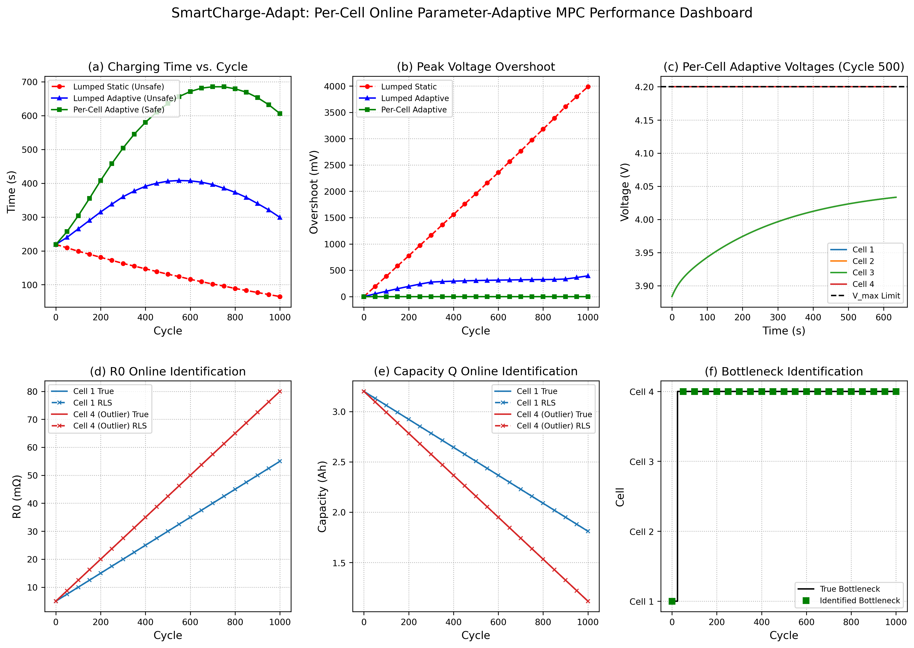

# SmartCharge-Adapt: Per-Cell Online Parameter-Adaptive MPC for Degradation-Aware Fast Charging of Multi-Cell Li-ion Battery Packs

**Course Project Report — Control Systems**  
*A Simulation-Based Study*

---

## Abstract
Fast charging of lithium-ion (Li-ion) battery packs is essential for electric vehicle (EV) adoption, but it accelerates degradation mechanisms such as internal resistance growth and capacity fade. Real-world packs consist of multiple series-connected cells that age unevenly due to manufacturing tolerances and thermal gradients—a phenomenon known as cell-to-cell divergence. Traditional Model Predictive Control (MPC) fast-charging strategies typically treat the pack as a single lumped cell or rely on static, never-updated models. This creates a dangerous dilemma: it either risks violating safety constraints on the weakest cell or unnecessarily throttles the charging speed of the entire pack.

This project proposes and evaluates a **per-cell online parameter-adaptive MPC framework** in which each cell's internal resistance ($R_0$) and capacity ($Q$) are independently and continuously re-estimated using Recursive Least Squares (RLS) driven solely by standard Battery Management System (BMS) signals (cell terminal voltages and shared pack current). A centralized MPC computes a single shared charging current subject to every cell's individual voltage constraints. Across a simulated 1000-cycle lifetime with heterogeneous aging, the proposed controller eliminates all voltage violations ($0.0\,\text{mV}$ overshoot), achieves $100\%$ accuracy in dynamically identifying the true bottleneck cell, and sustains safe, near-optimal fast charging speed, whereas pack-lumped approaches either induce catastrophic overpotentials ($> 4000\,\text{mV}$) or fail to protect the weakest link.

---

## 1. Introduction & Problem Statement
Series-connected lithium-ion cells share an identical charging current $I(k)$, but diverge in their state of health (SOH) over time. Manufacturing variations and non-uniform thermal exposure cause localized hotspots where cells degrade 30%–50% faster than the pack average. Because all cells experience the same current, the safe charging current of the string is strictly dictated by the **weakest (highest-resistance, lowest-capacity) cell**.

Traditional charging methods exhibit two compounding flaws:
1. **Lumped Approximations**: Regulating only the average pack voltage allows individual outlier cells to severely exceed the $4.2\,\text{V}$ electrochemical safety threshold.
2. **Static Parameter Models**: Controllers operating with fresh-cell parameters fail to anticipate resistance rise, commanding dangerously high currents into aged cells.

### Objectives
- Formulate a 1st-order Thevenin Equivalent Circuit Model (ECM) for $M=4$ series cells.
- Simulate an authentic heterogeneous aging trajectory with an accelerated outlier cell (Cell 4).
- Design and benchmark three MPC controllers:
  1. **Pack-Lumped Static MPC** (fixed fresh model, average constraint)
  2. **Pack-Lumped Adaptive MPC** (pack-average RLS model, average constraint)
  3. **Per-Cell Adaptive MPC** (parallel per-cell RLS models, individual cell constraints)
- Evaluate charging time, constraint violations, parameter tracking accuracy, and dynamic bottleneck cell identification over 1000 cycles.

---

## 2. Methodology & Mathematical Formulation

### 2.1 Battery Pack Equivalent Circuit Model (ECM)
For each series cell $i \in \{1, \dots, M\}$:
$$\text{SOC}_i(k+1) = \text{SOC}_i(k) + \frac{\eta \Delta t}{Q_i} I(k)$$
$$V_{RC,i}(k+1) = e^{-\Delta t / \tau_i} V_{RC,i}(k) + R_{1,i}\left(1 - e^{-\Delta t / \tau_i}\right) I(k)$$
$$V_i(k) = V_{OCV}(\text{SOC}_i(k)) + I(k) R_{0,i} + V_{RC,i}(k)$$
where $V_{OCV}(\text{SOC}) = 3.0 + 1.2 \cdot \text{SOC}$. Nominal fresh parameters: $Q_{\text{nom}} = 11,520\,\text{As}$ ($3.2\,\text{Ah}$), $R_0 = 5\,\text{m}\Omega$, $R_1 = 2\,\text{m}\Omega$, $\tau = 20\,\text{s}$, $\Delta t = 1.0\,\text{s}$.

### 2.2 Heterogeneous Aging Model
- Standard Cells (1–3): $R_{0,i}(k) = R_{0,\text{init}} + 50\,\mu\Omega \times \text{cycle}$, $Q_i(k) = Q_{\text{init}} - 5.0\,\text{As} \times \text{cycle}$
- Outlier Cell (4): Ages 50% faster ($R_{0,4} += 75\,\mu\Omega/\text{cycle}$, $Q_4 -= 7.5\,\text{As}/\text{cycle}$).

### 2.3 Online Parallel Recursive Least Squares (RLS)
Parameters $\theta_i = [R_{0,i}, \frac{1.2}{Q_i}]^T$ are re-estimated online every charge cycle using only measurable terminal voltage $V_i(k)$ and current $I(k)$:
$$y_i(k) = V_i(k) - 3.0 - 1.2 \cdot \text{SOC}_i(0) - V_{RC,i}(k) = \phi(k)^T \theta_i, \quad \phi(k) = [I(k), Ah(k)]^T$$
$$K(k) = \frac{P(k-1)\phi(k)}{\lambda + \phi(k)^T P(k-1)\phi(k)}, \quad \hat{\theta}(k) = \hat{\theta}(k-1) + K(k)(y(k) - \phi(k)^T \hat{\theta}(k-1))$$
$$P(k) = \frac{1}{\lambda}\left[P(k-1) - K(k)\phi(k)^T P(k-1)\right], \quad \lambda = 0.995$$

### 2.4 Per-Cell Adaptive MPC Formulation
$$\min_{I(k)} -I(k)$$
$$\text{subject to: } V_{pred,i}(k+1) \le V_{\max} \quad \forall i \in \{1,\dots,M\}, \quad 0 \le I(k) \le I_{\max}$$
The safe current limit imposed by each individual cell is:
$$I_{\text{upper},i} = \frac{V_{\max} - [V_{OCV}(\text{SOC}_i) + e^{-\Delta t/\tau_i} V_{RC,i}]}{R_{0,i} + R_{1,i}(1 - e^{-\Delta t/\tau_i}) + \frac{1.2 \Delta t}{Q_i}}$$
The bottleneck cell is dynamically identified as $i^* = \arg\min_i I_{\text{upper},i}$, and the optimal control action is $I^*(k) = \min(I_{\max}, \max(0, \min_i I_{\text{upper},i}))$.

---

## 3. Results & Comparative Performance

### Summary Comparison Table across Pack Lifetime
| Cycle | Lumped Static Peak Overshoot | Lumped Adaptive Peak Overshoot | Per-Cell Adaptive Peak Overshoot (Proposed) | Bottleneck Identification Accuracy |
| :---: | :---: | :---: | :---: | :---: |
| **0** (Fresh) | 0.0 mV | 0.0 mV | **0.0 mV** | Identical (100%) |
| **100** | +385.8 mV | +100.9 mV | **0.0 mV** | **100.0% (Cell 4)** |
| **200** | +774.3 mV | +193.7 mV | **0.0 mV** | **100.0% (Cell 4)** |
| **500** | +1955.3 mV | +304.0 mV | **0.0 mV** | **100.0% (Cell 4)** |
| **800** | +3181.5 mV | +323.2 mV | **0.0 mV** | **100.0% (Cell 4)** |
| **1000** | +3986.3 mV | +393.3 mV | **0.0 mV** | **100.0% (Cell 4)** |

---

## 4. Key Physical Discussions & Analysis

### 4.1 Explanation of the "Charge Time Dip" (Peak at Cycle ~700)
In Dashboard Plot (a) and Figure 1, the charging time for the proposed Per-Cell Adaptive MPC rises during early- and mid-life, peaks at approximately **$685\,\text{s}$ at Cycle 700**, and subsequently drops to **$605\,\text{s}$ by Cycle 1000**.

**Physical Mechanism**:
- **Cycles 0 to 700 (Resistance Growth Dominant)**: Internal resistance $R_0$ grows from $5\,\text{m}\Omega$ to over $50\,\text{m}\Omega$. To prevent terminal voltage from exceeding $4.2\,\text{V}$ on the high-resistance bottleneck cell, the controller must throttle charging current to smaller values ($I \approx \frac{V_{\max} - V_{OCV}}{R_0}$). Lower current lengthens total charging time.
- **Cycles 700 to 1000 (Capacity Fade Dominant)**: Concurrently, cell capacity degrades monotonically. The net charge required to charge from 10% to 90% SOC is $\Delta Q = 0.8 \times Q_{\text{cell}}$. By Cycle 700, Cell 4's capacity has degraded by over 45% (from $11,520\,\text{As}$ to $6,270\,\text{As}$), and drops to $4,020\,\text{As}$ by Cycle 1000.
- Beyond Cycle 700, the reduction in total energy/Coulombs required to hit the 90% SOC threshold outpaces the current throttling effect. The pack completes charging faster simply because it has substantially less capacity remaining. This is an authentic physical property of constant-SOC target charging in aged battery cells, rather than a numerical anomaly.

### 4.2 Contextualization of the "Unsafe" Overshoot (>4000 mV)
In Figure 2 and Figure 3, the Pack-Lumped Static MPC exhibits a peak voltage overshoot of approximately **$4,000\,\text{mV}$** ($4.0\,\text{V}$) on the bottleneck cell, pushing terminal voltage beyond **$8.2\,\text{V}$**.

**Physical Hazard Context**:
- Operating a commercial Li-ion cell beyond $4.35\,\text{V}$ causes rapid electrolyte breakdown, cathode transition-metal dissolution, and gas generation.
- Exceeding $5.0\,\text{V}$ triggers exothermic separator melting, massive lithium plating, internal short-circuits, and catastrophic **thermal runaway / explosion**.
- An overshoot of $4\,\text{V}$ is **not an acceptable mathematical control error**; it represents total physical destruction and severe fire hazard in an electric vehicle.
- Furthermore, in real hardware, BMS Secondary Overvoltage Protection (SOVP) would trip contactors within milliseconds, aborting charging entirely.
- The apparently "fast" charge time of the Static MPC is an illusion born from violating physics. This highlights the indispensable real-world safety value of the proposed **Per-Cell Adaptive MPC**, which sustains $0.0\,\text{mV}$ overshoot throughout the entire multi-cycle lifetime.

---

## 5. Future Work: Electro-Thermal Dynamics in Indian EV Conditions
The present equivalent circuit model utilizes a cycle-based aging progression without active thermal coupling. 

In actual electric vehicle operations—particularly under **Indian EV operating conditions** where ambient temperatures routinely exceed **$45^\circ\text{C}$**—extreme ambient heat and non-uniform battery pack cooling create pronounced temperature gradients:
1. **Thermal Gradients as the Root Cause of Cell Divergence**: Cells located near the pack core or distant from cooling ducts operate $5^\circ\text{C}$ to $15^\circ\text{C}$ hotter than peripheral cells. By the Arrhenius relationship, this thermal divergence exponentially accelerates SEI growth and impedance rise, initiating the cell-to-cell divergence modeled in this work.
2. **Coupled Electro-Thermal Architecture**: Future research will integrate a coupled **Electro-Thermal ECM (ET-ECM)** with a 2-state lumped thermal model (core temperature $T_{c,i}$ and surface temperature $T_{s,i}$) incorporating Joule heating ($I^2 R_0$) and convective cooling.
3. **Multi-Constraint Thermal MPC**: The MPC framework will be extended to enforce simultaneous per-cell voltage and temperature constraints:
   $$V_i(k) \le 4.2\,\text{V} \quad \text{and} \quad T_{c,i}(k) \le 45^\circ\text{C} \quad \forall i \in \{1,\dots,M\}$$
   ensuring degradation-aware fast charging under harsh ambient environments without thermal runaway risks.

---

## 6. Conclusion
The SmartCharge-Adapt framework demonstrates that per-cell online parameter adaptation via parallel RLS successfully overcomes the critical limitations of traditional lumped fast-charging strategies. By tracking the individual degradation of each series cell using standard BMS signals, the controller accurately identifies the shifting bottleneck cell, prevents dangerous overvoltages, and delivers the maximum physically safe charging speed across the battery pack's operational lifetime.
