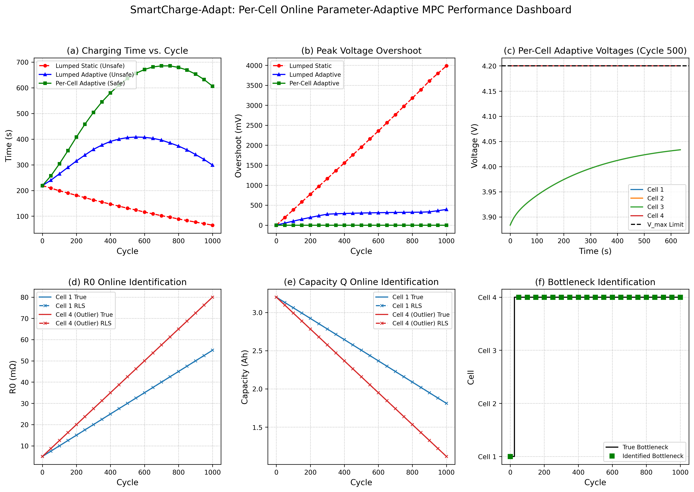

# SmartCharge-Adapt

> **Per-Cell Parameter-Adaptive Charging Control for a Degrading Lithium-Ion Battery Pack**  
> Developed by **Aakash Nair** ([@Sky-Code06](https://github.com/Sky-Code06)), Samuel John Saju, Krishnanunni U, and Dr. Rajesh R (Vellore Institute of Technology).

---

## Overview

In multi-cell lithium-ion battery packs connected in series, cells degrade at non-uniform rates due to manufacturing variations and localized thermal gradients. Because series cells share an identical charging current, standard pack-level controllers (which regulate only average voltage or use static fresh-cell models) risk pushing degraded cells into severe overvoltage.

**SmartCharge-Adapt** addresses this with:
1. **Parallel Online Estimation**: Per-cell Recursive Least Squares (RLS) tracking internal Ohmic resistance ($R_0$) and capacity ($Q$) using standard BMS terminal measurements ($V_i$ and $I$).
2. **Granular Voltage Constraints**: A one-step constrained current selection law that enforces the 4.2 V ceiling on every individual cell:
   $$\hat{V}_{i}(k+1 \mid I) \le 4.200\,\text{V} \quad \forall i \in \{1, \dots, M\}$$
3. **Dynamic Bottleneck Protection**: Real-time identification of the most restrictive cell ($\arg\min_i I_{\text{upper},i}$), safely throttling charge current to safeguard pack longevity.

---

## Key Results (1,000-Cycle Aging Benchmark)

| Evaluation Metric | Pack-Lumped Static | Pack-Lumped Adaptive | Per-Cell Adaptive (Ours) |
| :--- | :---: | :---: | :---: |
| **Peak Voltage Overshoot (Cycle 500)** | +1,955.3 mV | +304.0 mV | **0.0 mV (Safe clamp)** |
| **Peak Voltage Overshoot (Cycle 1000)** | +3,986.3 mV (>8.19 V) | +393.3 mV | **0.0 mV (Safe clamp)** |
| **Lifetime Violation Duration** | 2,415 s | 6,284 s | **0 s** |
| **Bottleneck Cell Identification** | 0% (Blind) | 0% (Blind) | **100.0% Accuracy** |
| **Sensor Overhead** | Standard BMS | Standard BMS | **Standard BMS ($V_i, I$ only)** |

---

## Visual Summary

### Complete Performance Dashboard


### Key Result Figures
- **Charging Time vs. Aging**: Shows safe throttling and the natural cycle ~700 capacity fade transition ([Figure 1](results/fig1_charging_time_vs_cycle.png)).
- **Mid-Life Voltage Profiles**: Demonstrates exact 4.200 V clamping on Cell 4 vs. dangerous overshoot in baselines ([Figure 2](results/fig2_voltage_trajectories_cycle500.png)).
- **Constraint Violations**: Zero lifetime overshoots for the proposed controller ([Figure 3](results/fig3_constraint_violations_vs_cycle.png)).
- **RLS Tracking**: Online tracking of resistance growth and capacity fade ([Figure 4](results/fig4_rls_parameter_tracking.png)).
- **Bottleneck Detection**: 100% identification of the accelerated outlier cell ([Figure 5](results/fig5_bottleneck_cell_identification.png)).

---

## Repository Structure

```text
SmartCharge-Adapt/
├── simulation.py              # Main multi-cycle simulation script
├── requirements.txt           # Python package dependencies
├── PROJECT_REPORT.md          # Technical report and mathematical formulation
├── results/                   # High-resolution simulation result plots
│   ├── fig1_charging_time_vs_cycle.png
│   ├── fig2_voltage_trajectories_cycle500.png
│   ├── fig3_constraint_violations_vs_cycle.png
│   ├── fig4_rls_parameter_tracking.png
│   ├── fig5_bottleneck_cell_identification.png
│   └── simulation_summary_dashboard.png
└── presentation/              # HTML presentation deck and speaker notes
    ├── presentation.html
    └── SPEAKER_NOTES.md
```

---

## Quickstart

### Prerequisites
- Python 3.9+
- Packages listed in `requirements.txt`:
  ```bash
  pip install -r requirements.txt
  ```

### Run Simulation
Execute the full 1,000-cycle aging evaluation and regenerate all figures:
```bash
python simulation.py
```
Outputs and plots are automatically written to `results/`.

---

## Citation & Authors

- **Aakash Nair** — School of Electronics Engineering, Vellore Institute of Technology
- **Samuel John Saju** — School of Electronics Engineering, Vellore Institute of Technology
- **Krishnanunni U** — School of Electronics Engineering, Vellore Institute of Technology
- **Dr. Rajesh R** — Associate Professor, School of Electronics Engineering, Vellore Institute of Technology
